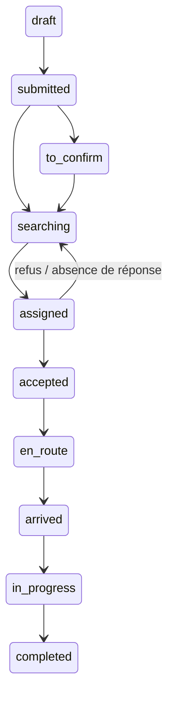

# Architecture

## Composants

Monorepo npm TypeScript : Next.js pour le web, NestJS pour REST, TypeORM et PostgreSQL pour la persistance, Expo/React Native pour Android. Les contrats de validation sont partagés. Les données restent côté API ; aucun composant client ne décide des droits.

Le choix npm workspaces évite un second gestionnaire de paquets. Pas de Redis ni de broker nécessaires au parcours actuel. La libération des propositions expirées et l’envoi des notifications sont déclenchés par la coordination. Un ordonnanceur avec verrou distribué sera nécessaire pour automatiser ces tâches sur plusieurs instances.

## Accès

| Rôle              | Périmètre                                                                                            |
| ----------------- | ---------------------------------------------------------------------------------------------------- |
| Client            | Son compte, ses bénéficiaires autorisés, ses demandes, factures, reçus, tickets et notes accessibles |
| Médecin/infirmier | Son profil, justificatifs, disponibilités et missions attribuées ; notes de ces missions             |
| Coordination      | Demandes, recherche et affectation, devis, suivi opérationnel, support et notifications              |
| Administrateur    | Validation professionnelle, suspension, catalogue, zones, paramètres, finances et audit              |

Les administrateurs et opérateurs ne lisent pas les notes cliniques. Un professionnel non vérifié ne reçoit pas de mission. Après refus/réaffectation, l’ancien intervenant perd l’accès. Aucune carte publique de localisation des professionnels n’est exposée. L’inscription publique ne permet jamais de choisir administrateur ou opérateur.

## Machine à états

Les autres transitions de cancellation/échec autorisées sont définies dans packages/contracts/src/index.ts et contrôlées côté serveur. Chaque événement enregistre l’acteur et la date. La fin d’un soin requiert un devis et crée une seule facture. Seul le professionnel affecté fait progresser l’intervention. Les boutons sont générés selon les droits, mais les vérifications serveur sont obligatoires.

Les transactions verrouillent les demandes et utilisent un verrou consultatif par professionnel. Un index d’affectation active et une contrainte PostgreSQL d’exclusion GiST empêchent les doubles affectations et chevauchements, même en concurrence. Une indisponibilité ne peut pas recouvrir une mission déjà affectée. Les disponibilités habituelles peuvent être matérialisées pour quatre semaines via POST /professional/availability/weekly ; l’interface propose aussi des périodes explicites.

## Géographie

PostGIS utilise une colonne geography générée et un index GiST, puis calcule la distance et filtre le rayon. Sans PostGIS en développement, un calcul Haversine prend le relais. Le serveur refuse ce remplacement en production. Le poste local n’a pas l’extension PostGIS ; cette branche nécessite un essai sur l’image Docker fournie.

La localisation est facultative et demandée à l’action de l’utilisateur. L’adresse manuelle demeure disponible en cas de refus. Les itinéraires ouvrent OpenStreetMap. Le formulaire web permet de sélectionner un point sur une carte après accord, par clic ou au clavier. Android conserve GPS et adresse manuelle ; le sélecteur natif reste à ajouter. Voir INTEGRATIONS pour le fournisseur.

## Persistance

Migrations versionnées pour utilisateurs, sessions, professionnels, justificatifs, bénéficiaires, consentements, catalogue, zones, disponibilités, soins, affectations, événements, consultations, notes, factures, paiements, événements marchands, remboursements, notifications, livraisons, préférences, tickets, paramètres et audit. Les détails sensibles utilisent AES-256-GCM avec IV aléatoire. Les fichiers privés sont chiffrés avant stockage local ou S3.

Le récapitulatif professionnel affiche les montants bruts facturés sur ses missions. La répartition contractuelle, les commissions et les versements aux professionnels ne sont pas implémentés : aucun total affiché ne constitue une rémunération due ni une preuve de virement.

## Transactions financières

Une facture est payable après completed. La réservation sous verrou évite deux paiements en attente ; les clés d’idempotence sont liées au demandeur et à l’empreinte de la requête. Un retour navigateur ne solde rien. Un webhook signé est dédupliqué puis le serveur interroge le prestataire pour comparer référence, montant, devise et statut. Une initiation marchande au résultat incertain reste à rapprocher manuellement pour éviter un double débit. Les remboursements réels sont des dossiers manual_review, sans promesse de transfert bancaire.
